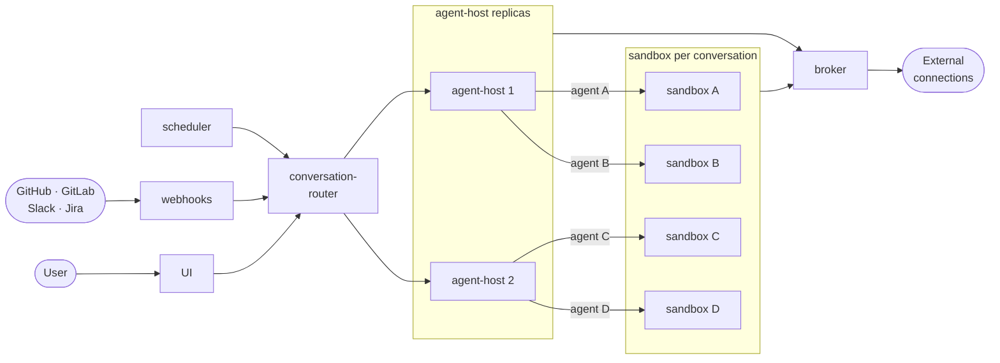

# Architecture

Scooter runs the agent **outside** its sandbox. The agent-host runs the agent process
(Goose over ACP, by default) and carries out each tool call by exec'ing into the
conversation's sandbox pod through the Kubernetes API. The sandbox is a plain NixOS
machine with no agent inside it. Everything it reaches outside the cluster goes through
the broker, which holds the credentials.

## Components

| Component | What it does |
|---|---|
| **UI** | Serves the chat app. Its nginx proxies the API to the router and contribs' public paths to the broker. |
| **conversation-router** | Sits in front of every agent-host. It looks up which host pod owns a conversation and proxies the request (HTTP, SSE or WebSocket) there. It also serves each conversation's web services on `*.sandboxDomain`. |
| **conversation-controller** | Leader-elected. It assigns each conversation to an agent-host pod and reassigns conversations when a pod goes away, so any replica can pick up any conversation. It also scales the agent-host fleet to demand. |
| **agent-host** | Runs one agent session per live conversation and bridges ACP to AG-UI for the browser. It provisions, suspends and resumes sandboxes, and runs tool calls by exec'ing into them. |
| **Sandbox** | A `Sandbox` object from [agent-sandbox](https://github.com/kubernetes-sigs/agent-sandbox), one per conversation, with its own ServiceAccount. An idle sandbox is suspended and keeps its workspace and installed tools. |
| **broker** | The only holder of credentials. It authenticates sandboxes by their ServiceAccount token (TokenReview), applies the permission rules and approvals, and vends short-lived credentials or proxies the request. Forge traffic (`git`, `gh`) goes through its proxy, so the sandbox never holds a token. |
| **webhooks** | Receives GitHub, GitLab, Slack and Jira events and turns them into prompts for the right conversation. |
| **scheduler** | Fires scheduled tasks as new or existing conversations. |
| **byoc-controller** | Optional. Holds the WebSocket from each [bring-your-own-Claude](features/byoc.md) container so any agent-host can drive it. |

## Network boundaries

When the CNI enforces NetworkPolicy, Scooter's policies mean that:

- sandboxes reach only the broker, its forge proxy, the router's self-access listener, DNS and the internet, and never each other;
- only the agent-host and the router reach a sandbox, and only the agent-host reaches its MCP servers (ports 9700-9799);
- only the router and the conversation-controller reach agent-host pods.
