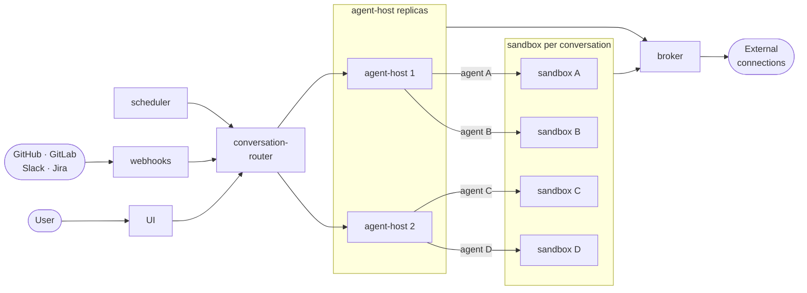

# Architecture

Scooter runs the agent **outside** its sandbox. The agent-host runs the agent process
(Goose over ACP, by default) and carries out each tool call by exec'ing into the
conversation's sandbox pod through the Kubernetes API. The sandbox is a plain NixOS
machine with no agent inside it. Everything it reaches outside the cluster goes through
the broker, which holds the credentials.

## Components

The first five components do the core work: running the agent, isolating it and
holding its credentials. The rest support them.

### Sandbox

Each conversation gets its own sandbox: a `Sandbox` object from
[agent-sandbox](https://github.com/kubernetes-sigs/agent-sandbox) running a plain NixOS
machine. The agent's shell commands and file edits all run here.

- It has its own ServiceAccount, `sandbox-<id>`, which is its identity to the broker.
- Its workspace lives on a persistent volume, so files and installed tools survive.
- An idle sandbox is suspended and resumed on the next message, with its workspace intact.
- It holds no credentials. Anything outside the cluster is reached through the broker.

### Broker

The broker is the only component that holds credentials. Every call a sandbox makes to
an outside service goes through it.

- It authenticates each sandbox by its ServiceAccount token, checked with a TokenReview.
- It applies the deployment's permission rules, and asks the user to approve a request
  when a rule says so.
- It either vends a short-lived credential or makes the request itself.
- Forge traffic (`git`, `gh`) goes through its forge proxy, which adds the token on the
  way out, so the sandbox never sees it.
- Contribs add their own routes and agent tools to it.

### Webhooks

The webhooks service lets outside events start or steer conversations.

- It receives events from GitHub, GitLab, Slack and Jira.
- It turns each event into a prompt and sends it to the right conversation, creating a
  new one if needed.
- Each contrib registers the handlers for its own provider.

### Agent-host and conversation-router

The agent-host is a horizontally scalable service that runs the agents. Each replica runs
the agent sessions for many conversations, and carries out their tool calls by exec'ing
into each conversation's sandbox through the Kubernetes API. It also creates, suspends
and resumes those sandboxes.

The agent is kept out of its sandbox on purpose. Secrets the agent process needs, such as
its model credentials, stay in the agent-host and never enter the sandbox, where the
agent runs arbitrary code. And because the sandbox holds no agent state, it can be resized
or restarted without interrupting the agent's session.

The conversation-router sits in front of the agent-host replicas. Each conversation is
owned by one replica, and the router sends every request for it there, whether HTTP, SSE
or WebSocket. It also checks who the caller is and whether they may see the conversation,
and it serves each conversation's web services from their own origin on
`*.sandboxDomain`.

### Supporting services

- **UI:** serves the chat app. Its nginx proxies the API to the router and contribs'
  public paths to the broker.
- **Conversation-controller:** assigns each conversation to the least-loaded ready
  agent-host pod, and reassigns it when that pod goes away, so any replica can pick up any
  conversation. It also scales the agent-host fleet to demand. It is leader-elected, so
  only one replica acts at a time.
- **Scheduler:** stores scheduled tasks and fires each one when it is due, as a new
  conversation or a prompt to an existing one.
- **BYOC-controller** (optional): holds the WebSocket from each
  [bring-your-own-Claude](features/byoc.md) container, so any agent-host can drive it.
- **Warm-store-controller** (optional): keeps a pool of pre-filled `/nix/store` volumes so
  new sandboxes start faster.

## Network boundaries

When the CNI enforces NetworkPolicy, Scooter's policies mean that:

- sandboxes reach only the broker, its forge proxy, the router's self-access listener, DNS and the internet, and never each other;
- only the agent-host and the router reach a sandbox, and only the agent-host reaches its MCP servers (ports 9700-9799);
- only the router and the conversation-controller reach agent-host pods.
